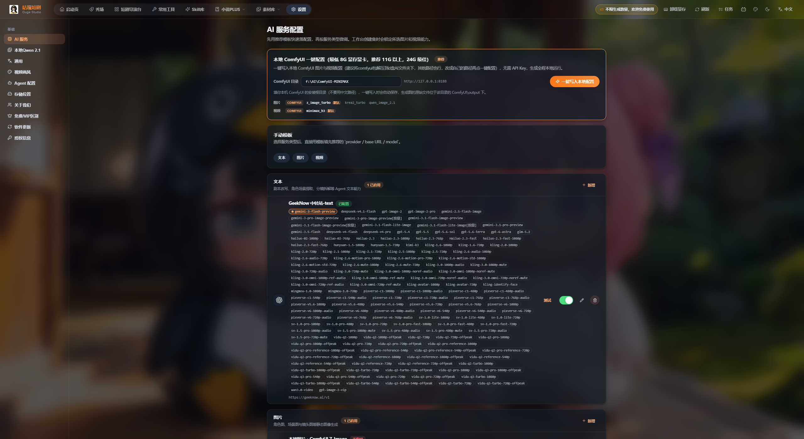
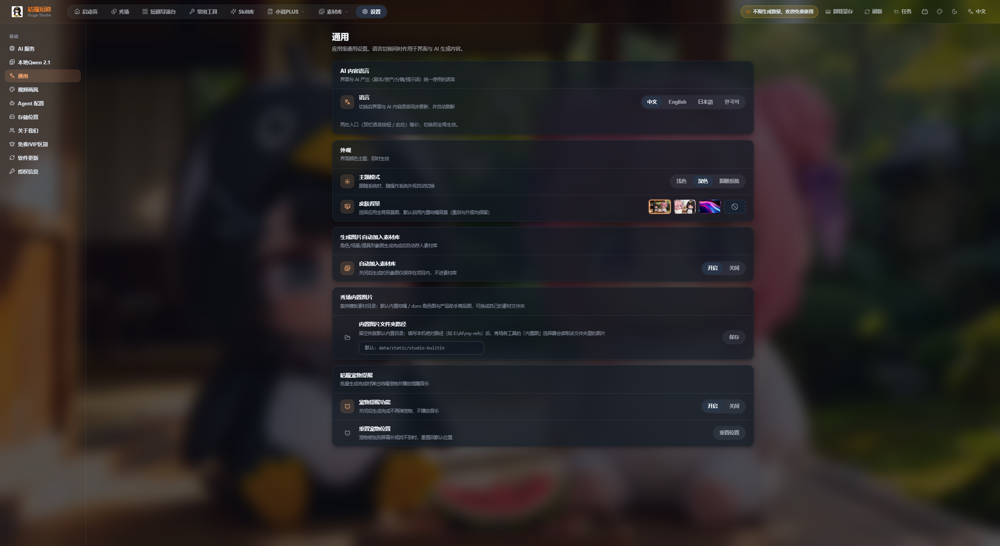
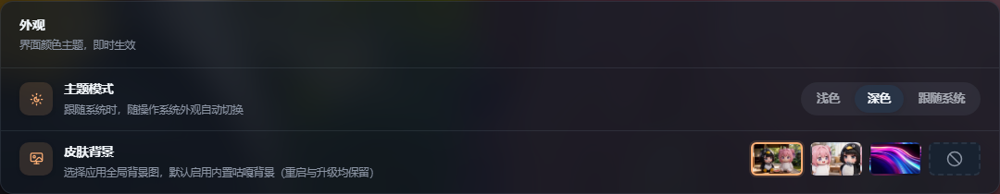
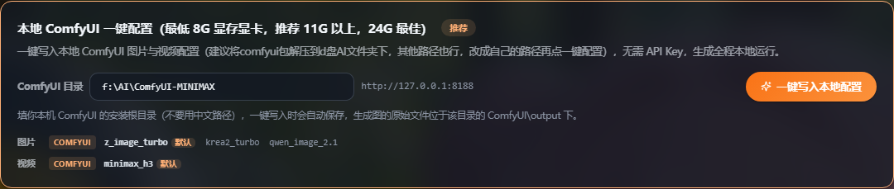
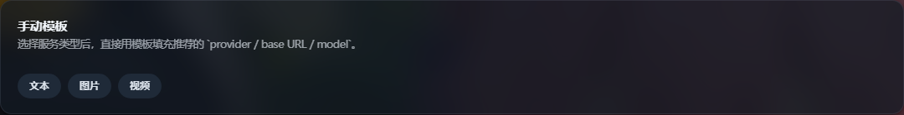
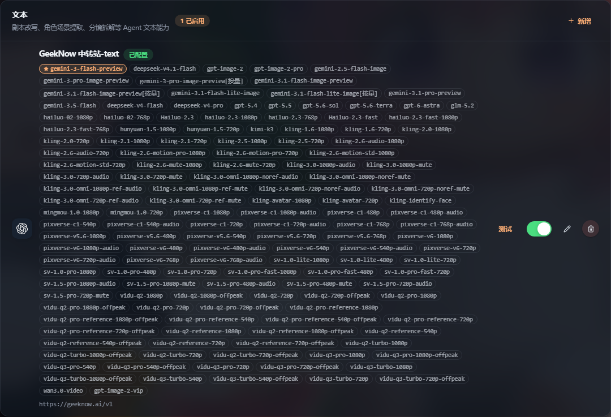
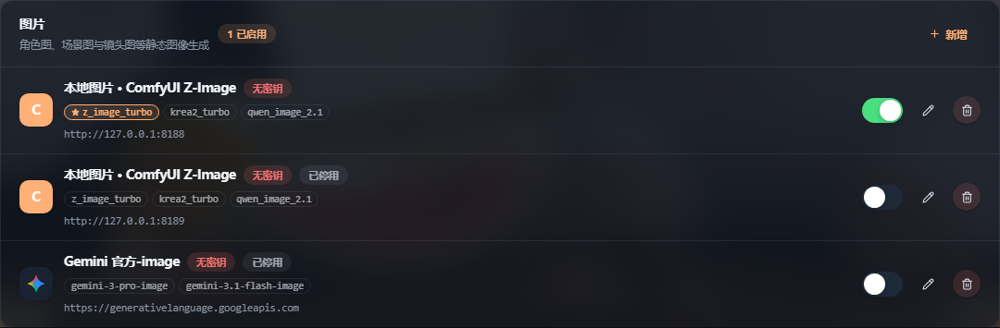
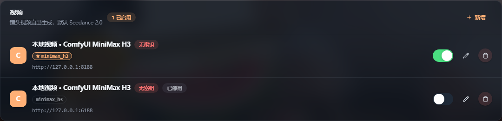
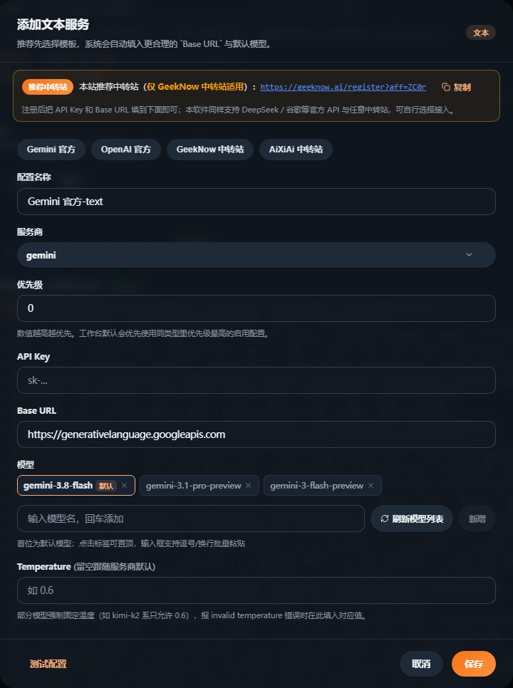

# 咕嘎AI漫剧 · AI 服务配置图文教程

> 入口：左上角 **设置 → 基础 → AI 服务**
> 配套图文版（深色主题，含真实界面截图）：`咕嘎AI漫剧-AI服务配置图文教程.html`
> 图片目录：`图片/`

---

## 0. AI 服务配置页总览

页面结构：

- **左侧导航**：基础（AI 服务 / 本地Qwen 2.1 / 通用 / 视频画风 / Agent 配置 / 存储位置…）
- **顶部快速配置卡**：本地 ComfyUI 一键写入，官方标注「推荐」
- **手动模板卡**：文本 / 图片 / 视频 三个模板按钮，一键填好服务商与默认模型
- **三类服务卡**：每张卡右上角「＋ 新增」，卡片内是已配置的服务条目

官方提示：**「先用推荐模板快速落配置，再按服务类型微调。工作台创建集时会锁定所选图片和视频能力。」**
→ 先在这里配好，再去短剧导演台创建集；集建好后该集的能力即固定。

三类能力：

| 类型 | 用途 |
| --- | --- |
| 文本 | 剧本改写、角色场景提取、分镜拆解等 Agent 文本能力 |
| 图片 | 角色图、场景图与镜头图等静态图像生成 |
| 视频 | 镜头视频直出生成，默认 Seedance 2.0 |

---

## 1. 开启深色主题

1. 左侧导航点 **通用**
2. **外观** 卡片 → **主题模式** → 点 **深色**
3. **皮肤背景** 可选预设图或纯色背景，不影响功能
4. 想跟随系统自动切换就选「跟随系统」

> 顶部导航栏右侧也有主题快捷按钮（月亮图标），点击在 浅色 → 深色 → 跟随系统 之间循环。

---

## 2. 路线 A：本地 ComfyUI 一键配置（推荐）

适用：有 NVIDIA 显卡（**最低 8G 显存，推荐 11G 以上，24G 最佳**），本地已装好 ComfyUI。**无需 API Key，全程本地运行。**

1. 解压 ComfyUI 到例如 `D:\AI\ComfyUI-MINIMAX`（路径**不要用中文**）
2. 在 **ComfyUI 目录** 输入框填安装根目录
3. 确认端口，默认 `http://127.0.0.1:8188`（与 ComfyUI 默认一致）
4. 点 **一键写入本地配置**，系统自动保存并写入图片 + 视频两套配置

写入结果：

- 图片 → 「本地图片 · ComfyUI Z-Image」，模型 `z_image_turbo`（默认）、`krea2_turbo`、`qwen_image_2.1`
- 视频 → 「本地视频 · ComfyUI MiniMax H3」，模型 `minimax_h3`（默认）
- 生成原始文件在该目录的 `ComfyUI\output` 下

> 路径必须指向 ComfyUI **安装根目录**（里面就有 `ComfyUI\output` 的那一层），不是 output 子目录。

---

## 3. 路线 B：手动模板快速填参

选择服务类型后，模板自动填入 `provider / base URL / model`，你只需补 API Key。

| 模板 | 服务商 provider | Base URL | 预置模型 |
| --- | --- | --- | --- |
| 文本 | openai / gemini | `https://geeknow.ai/v1`、`https://api.aixiai.top/v1`、官方地址 | gemini-3-flash-preview、gpt-5.6-terra 等 |
| 图片 | gemini / openai / comfyui | 官方地址 / `http://127.0.0.1:8188` | gemini-3-pro-image、gpt-image-2、z_image_turbo… |
| 视频 | volcengine / minimax / comfyui | 火山引擎 / MiniMax 官方 / 本地 8188 | doubao-seedance-2-0 系列、MiniMax-H3、minimax_h3 |

---

## 4. 三类能力分别怎么配

| 元素 | 含义 | 怎么用 |
| --- | --- | --- |
| 已配置 / 无密钥 | 是否填了 API Key，本地 ComfyUI 显示「无密钥」属正常 | 云端服务必须显示「已配置」 |
| 已停用 | 该条目已关闭，不参与调用 | 右侧开关打开即可 |
| ⭐ 模型标签 | 该类型的**默认模型**，工作台优先调用 | 点其他标签可把它设为默认 |
| 灰色模型标签 | 备用模型 | 点击即置顶为默认 |
| `http://…` | 该服务的 Base URL | 排错先核这一行 |
| 开关 / 铅笔 / 垃圾桶 | 启用停用 / 编辑 / 删除 | 删除不可撤销 |
| 测试（仅文本） | 立即验证连通性 | 改完 Key / URL 立刻点 |

> 同类型可有多条启用配置，工作台**优先使用优先级数值最高**的启用配置，失败再回落下一条 → 「本地兜底 + 云端保底」。

---

## 5. 新增 / 编辑服务配置逐项详解

在任意服务卡点「＋ 新增」，或点已有条目的铅笔图标打开弹窗。

| 字段 | 说明 |
| --- | --- |
| 顶部提示条 | 默认推荐中转站 GeekNow 并附注册链接 |
| 模板按钮 | Gemini 官方 / OpenAI 官方 / GeekNow 中转站 / AiXiAi 中转站，点一下自动填服务商、Base URL、默认模型 |
| 配置名称 | 自定义显示名，如「咕嘎默认图像服务」 |
| 服务商 | gemini / openai / volcengine / minimax / comfyui |
| 优先级 | 0–999，**数值越高越优先**；本地建议 98–99，云端备用 50 以内 |
| API Key | 密码框，云端必填，本地留空 |
| Base URL | 官方地址 / 中转站地址（通常带 `/v1`）/ `http://127.0.0.1:8188` |
| 模型 | 回车添加，**首位为默认模型**；点标签置顶；「刷新模型列表」可拉取可用模型 |
| Temperature | 0–2，留空跟随服务商默认；报 invalid temperature 时按提示填固定值（如 0.6） |
| 底部按钮 | **测试配置** → 确认「端点已响应」 → **保存** |

**推荐操作顺序**：模板 → 配置名称 → 服务商 → 优先级 → API Key → Base URL → 模型（可刷新）→ 测试配置 → 保存。

---

## 6. 三套开箱即用方案

| 方案 | 适合谁 | 配置动作 | 成本 |
| --- | --- | --- | --- |
| **全本地** | 有独显（8G 显存起），不想花钱、素材不出本机 | 路线 A 一键写入；文本另接云端 API 或本地模型 | 电费 |
| **云端主力** | 无独显或要更高质量 | 文本选 GeekNow/AiXiAi，图片选 Gemini 或 gpt-image-2，视频选 Seedance 2.0 或 MiniMax H3 | 按量计费 |
| **本地 + 云端双保险**（推荐） | 正式生产，不想赶稿时卡住 | 本地优先级 99、云端同类型优先级 50，两条都启用 | 按量计费 |

---

## 7. 常见问题排查

1. **「无法连接服务器，请检查网络或服务是否已启动」**
   ComfyUI 未启动 / 端口不对。确认浏览器能打开 `http://127.0.0.1:8188`；端口被占用则两边同时改；地址用 `127.0.0.1` 而非 `localhost`。
2. **invalid temperature**
   部分模型（kimi-k2 系）只接受固定温度，按提示填 `0.6` 等值，不要留空。
3. **配置了但生成没变化**
   工作台选中的集是配置前创建的（创建集即锁定能力）；确认默认模型带 ⭐；确认条目不是「已停用」。
4. **刷新模型列表失败**
   中转站未开放 `/v1/models`，手动输入模型名即可，不影响调用。
5. **中文路径行不行？**
   不行，官方明确提示不要用中文路径，请迁到纯英文/数字路径。

---

## 8. 配置完成检查清单

- [ ] 三张服务卡（文本 / 图片 / 视频）都能看到
- [ ] 文本：至少 1 条启用配置，显示「已配置」，默认模型带 ⭐
- [ ] 图片：至少 1 条启用配置，Base URL 正确，默认模型带 ⭐
- [ ] 视频：至少 1 条启用配置，默认模型带 ⭐
- [ ] 用本地 ComfyUI 的，确认 `http://127.0.0.1:8188` 可打开
- [ ] 新增/编辑过的配置点过「测试配置」并看到「端点已响应」
- [ ] 多配置共存时优先级符合预期
- [ ] 模型输出尺寸与项目需求一致（横屏 1080P / 竖屏 768P 等）
- [ ] 主题已切到「深色」（设置 → 通用 → 外观）
- [ ] 全部就绪后，再去**短剧导演台**创建集并锁定能力
