# 咕嘎AI漫剧 · 短剧导演台图文教程

> 入口：顶部导航 → **短剧导演台**
> 配套图文版（深色主题，含真实界面截图）：`咕嘎AI漫剧-短剧导演台图文教程.html`
> 图片目录：`图片/`

---

## 0. 导演台全景与三步路线

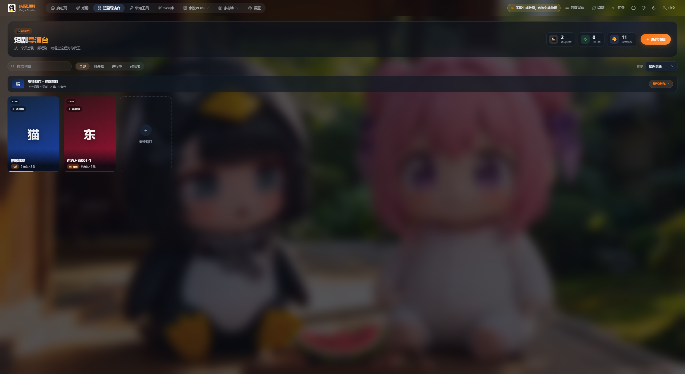

短剧导演台不是单页，而是一条流水线：**项目库 → 项目详情（剧集 + 素材库）→ 单集工作台（四步流水线）**。

| 层级 | 做什么 |
| --- | --- |
| 项目库 | 新建项目、封面管理、搜索与状态筛选 |
| 项目详情 | 剧集列表 + 项目素材库（角色/场景/道具） |
| 单集工作台 | 原文改写 → 资产制作 → 分镜视频 → 成片合成 |

三步上手：

1. 先在 **设置 → AI 服务** 配好文本 / 图片 / 视频能力。
2. 回导演台 **新建项目**，定好名称、视觉风格与画面比例。
3. 进入项目 → **添加集** → 单集工作台，按左侧 **四步流程** 从上往下走，最后下载成片。

> 两个锁定规则：画面比例**建项目时**定死不可改；**建集时**自动锁定当前启用的图片与视频生成能力。

---

## 1. 项目库：卡片、搜索、筛选、排序

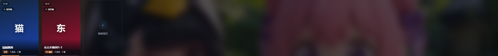

| 控件 | 作用 |
| --- | --- |
| 搜索项目 | 按名称即时过滤 |
| 全部 / 待开始 / 进行中 / 已完成 | 按状态筛选 |
| 排序：最近更新 / 标题 | 调整卡片顺序 |
| ＋ 新建项目 | 右上角橙色按钮 |
| 卡片左上 9:16 角标 | 项目锁定的画幅比例 |
| 状态徽章 | 待开始 / 进行中 / 已完成 |
| 设置封面 | 上传或更换封面 |
| 末尾虚线卡 | 快捷创建入口 |

右上角实时显示：项目总数 / 进行中数量 / 视觉风格数量。

---

## 2. 新建项目：名称 / 风格 / 比例

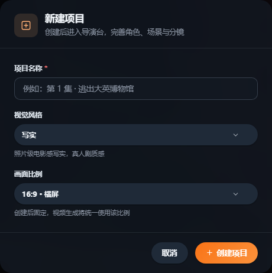

1. **项目名称 \***：建议写成「集名 + 核心事件」
2. **视觉风格**：如「写实」，决定全片画面基调
3. **画面比例**：16:9 横屏 / 9:16 竖屏 / 1:1 方形 / 自适应 —— **创建后固定，视频生成统一使用该比例**
4. 点 **＋ 创建项目**，直接进入项目详情页

> 抖音/快手/视频号选 **9:16**；B 站等横屏平台选 **16:9**。

---

## 3. 继续制作与卡片快捷菜单

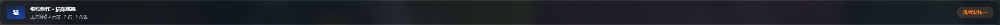

「继续制作」横幅显示最近编辑的项目、上次编辑时间、集数与角色数，点右侧「继续制作 →」直接跳回那一集。

卡片右上角 **⋯** 菜单：打开项目 / 设置封面 / 重命名 / 加入系列 / 删除项目（危险操作）。

---

## 4. 项目详情页：剧集列表

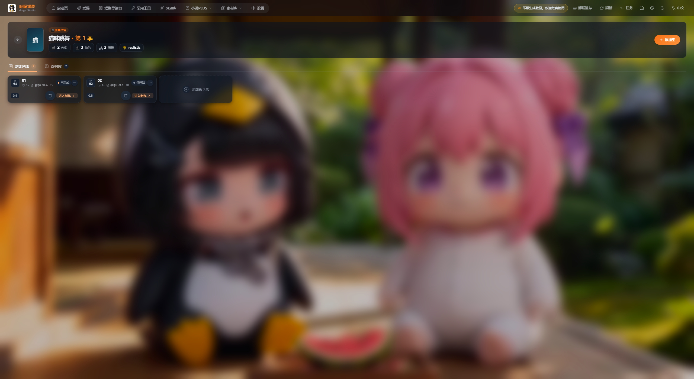

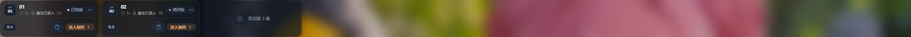

顶部项目信息条：封面、标题、季数、集数、角色数、场景数、风格标识；左上角 ← 返回项目库；右上角 **＋ 添加集**。

剧集卡片：集号与标题、进度标记（已完成/待开始）、分镜数量、**进入制作 →**、删除图标；末尾虚线卡「添加第 N 集」。

下方两个标签：**剧集列表** / **素材库**。

---

## 5. 创建新集与分辨率锁定

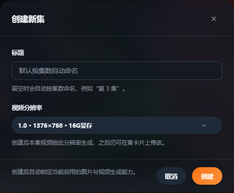

| 字段 | 说明 |
| --- | --- |
| 标题 | 留空自动按集数命名（如「第 3 集」） |
| 视频分辨率 | 如 `1.0 · 1376×768 · 16G显存`，显存不足时降一档 |
| 底部提示 | 「创建后会自动锁定当前启用的图片与视频生成能力。」 |

> 建集前先去设置页确认 AI 服务的默认模型（带 ⭐）是你想要的。

---

## 6. 项目素材库：角色 / 场景 / 道具

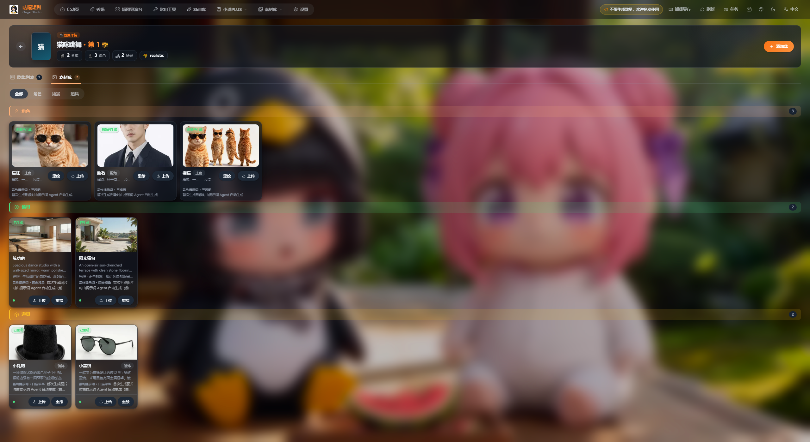

按「角色 / 场景 / 道具」分组，每张卡片含：绿色「已生成」角标、名称与定位标签、英文外观描述、**上传** / **重绘** 按钮。

> 角色图、场景图、道具图会自动带入分镜的「参考素材」，保证同一角色每个镜头一致。角色定妆后建议上传一张满意的定妆照。

---

## 7. 单集工作台：顶部参数条与四步流程

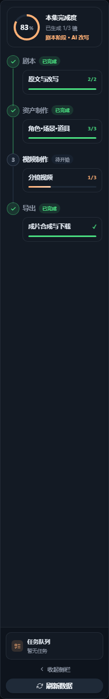

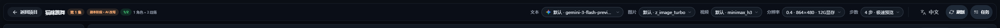

| 参数 | 示例 | 说明 |
| --- | --- | --- |
| 文本 | `默认 · gemini-3-flash-preview` | 剧本改写、分镜拆解 |
| 图片 | `默认 · z_image_turbo` | 角色图/场景图/分镜图 |
| 视频 | `默认 · minimax_h3` | 镜头视频生成 |
| 分辨率 | `0.4 · 864×480 · 12G显存` | 越大越清晰、显存占用越高 |
| 步数 | `4 步 · 极速预览` | 4 步出草稿快 |

左侧步骤栏显示完成度圆环 + 剧本 / 资产制作 / 视频制作 / 导出 四步，绿勾 = 已完成。

---

## 8. 步骤 1 · 原文与改写

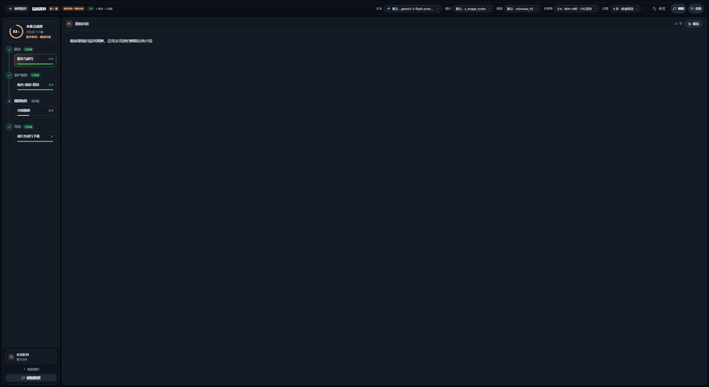

1. 粘贴小说原文
2. 点「改写」，AI 按短剧节奏重写
3. 不满意点「重新改写」，想保留原文点「跳过改写」
4. 右上角可切换文本模型

---

## 9. 步骤 2 · 角色·场景·道具

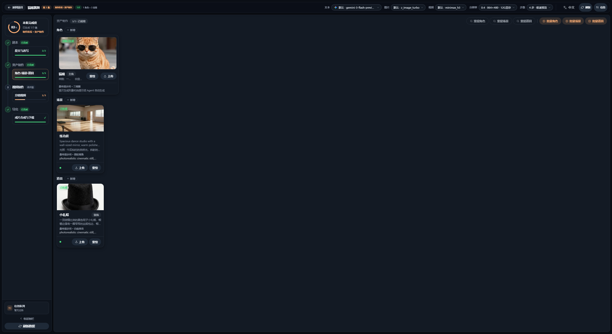

- 顶部「重绘角色/场景/道具」或「批量角色/批量场景/批量道具」批量生成
- 每张卡片可「重绘」或「上传」替换
- 全部确认后自动打勾，进入分镜环节

---

## 10. 步骤 3 · 分镜视频

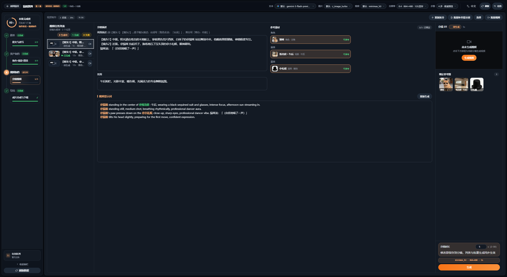

| 区域 | 内容 | 要点 |
| --- | --- | --- |
| 分镜任务列表（最左） | 缩略图、状态（生成中/已完成/失败）、耗时 | 点某镜切到右侧编辑 |
| 分镜描述 | 画面描述 + 台词 + 运镜 | 可手动改字 |
| 氛围 | 光线、色彩、情绪基调 | 决定成片调性 |
| 视觉提示词 | 英文 prompt，@角色/@场景/@道具 | 点「重新生成」换一版 |
| 参考素材 | 本镜要用的角色/场景/道具 | 点缩略图增删引用 |

流程：点「重新拆分」可重拆镜，「批量补提示词」一次性补齐 → 检查 prompt → 右下设置**分镜时长（秒）** → 点橙色**生成** → 失败可单独重试。

---

## 11. 步骤 4 · 成片合成与下载

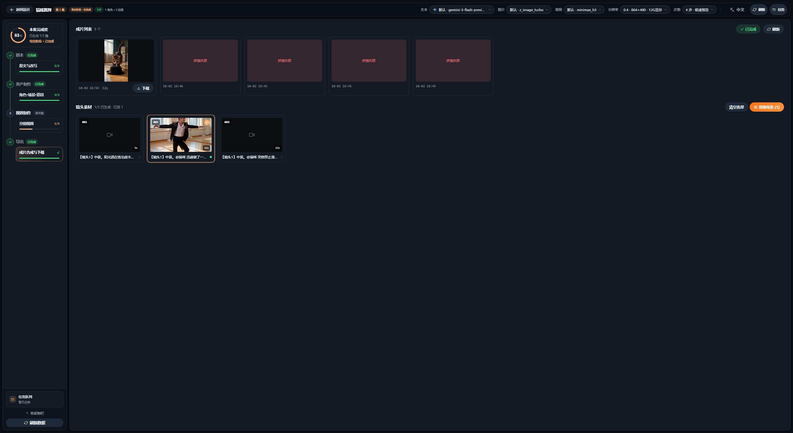

1. **成片列表**：每个已完成镜头的成片，可单独「下载」
2. **镜头条目**：一镜一条，勾选框决定是否参与拼接
3. 「清空选择」重置，橙色「拼接所选 (N)」合成视频
4. 顶部绿色 ✓ 已完成 = 本集流程完成；右上「刷新」同步任务状态

> 红色「拼接失败」占位 = 该镜未生成成功，回步骤 3 重生成后再拼接。

---

## 12. 常见问题与提效技巧

| 现象 | 处理 |
| --- | --- |
| 生成失败 / 显存不足 | 降一档分辨率，步数保持 4；本地 ComfyUI 建议 8G+ 显存 |
| 画面比例不对 | 建项目时已固定，只能新建项目 |
| 换模型后成片没变 | 建集时已锁定能力，需新建一集 |
| 角色每镜头不一样 | 素材库上传定妆照，并勾选该角色为参考素材 |
| 成片拼接失败 | 有镜头未生成成功，回步骤 3 重生成 |
| 状态不同步 | 左下角「刷新数据」 |

提效：草稿低分辨率 + 4 步极速预览跑通全片再提清晰度；优先用批量按钮；用「继续制作」横幅回到现场；左侧步骤栏当进度看板；顶部模型下拉即时切换。

---

## 13. 出片检查清单

- [ ] 项目名称、视觉风格、画面比例已按投放平台选定
- [ ] 项目封面已上传
- [ ] 设置页三类默认模型（带 ⭐）已确认
- [ ] 步骤 1 改写稿已定稿或已跳过
- [ ] 主要角色已上传定妆照，场景道具齐全（3/3）
- [ ] 分镜数量与节奏匹配，描述/氛围/提示词已核对
- [ ] 所有镜头「已完成」，无红色「拼接失败」
- [ ] 分镜时长设置合理（单镜 3–8 秒为主）
- [ ] 「拼接所选」成功生成成片并下载
- [ ] 项目状态更新为「已完成」
