# 咕嘎AI漫剧 · 八大工作台图文教程

> 入口：顶部导航 → **秀场**
> 配套图文版（深色主题，含真实界面截图）：`咕嘎AI漫剧-八大工作台图文教程.html`
> 图片目录：`图片/`

---

## 0. 秀场与八大工作台地图

所有工作台都在顶部导航「秀场」里：一级选领域，二级选具体工作台。

| # | 工作台 | 能力 | 路径 |
| --- | --- | --- | --- |
| ① | 武打助手 | 全屏专业工作台：Skill 市场 + 角色/场景库 + 镜头编排 + 分镜时间线 + 一键成片 | 秀场 → 打戏助手 → 专业工作台 |
| ② | 武打助手提示词版本 | 整段 H3 提示词 → 自动拆段 → 逐段生成 → 自动拼片 | 秀场 → 打戏助手 → 武打助手提示词版本 |
| ③ | 文戏助手 | 剧本一键分镜，对白驱动分段连拍，角色声线锁定 | 秀场 → 文戏助手 |
| ④ | 多图舞蹈 | 首帧 + 多张参考图共同锚定舞者，整曲编舞分段接力 | 秀场 → 舞蹈助手 → 多图舞蹈 |
| ⑤ | 数字人 | 人物图 + 口播/演唱音频，长音频自动分段，唇形同步 | 秀场 → 数字人 |
| ⑥ | 产品 PV | MV 六段式导演提示词，首尾帧强控，成片音乐一致 | 秀场 → 产品助手 |
| ⑦ | 字幕转视频 | 字幕/文案驱动的手绘涂鸦·图形动效短片 | 秀场 → 口播助手 → 字幕转视频 |
| ⑧ | 数字人口播 | 人物形象 + 口播音频驱动的 MG 图形风口播视频 | 秀场 → 口播助手 → 数字人口播 |

两种形态：**全屏专业工作台**（武打助手）与**项目式工作台**（其余 7 个，统一「新建项目 → 分镜工作台」）。

通用流程：新建项目 → AI 分镜 → 分段生成 → 拼接成片。

---

## 1. 武打助手（专业工作台）

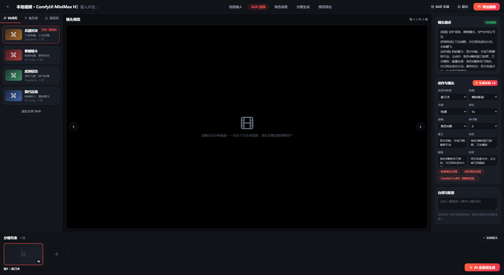

| 区域 | 内容 |
| --- | --- |
| 左栏 | Skill 库（兵器对决/拳脚格斗/武侠轻功/现代近战）、角色库、场景库；右上「Skill 市场 / 保存 / 导出视频」 |
| 中栏 | 镜头预览 + 左右翻页；未生成时提示「该镜头还没有画面——先在下方生成视频，或在左侧设置首帧资产」 |
| 右栏 | 镜头描述（自动装配，可恢复自动）、动作与镜头（招式/运镜/节奏/时长/首帧/种子数/蓄力·出招·碰撞·反馈）、台词与配音 |
| 底栏 | 分镜列表（每镜缩略卡 + 添加镜头），右下橙色「AI 全自动生成」 |

步骤：

1. 秀场 → 打戏助手 → 专业工作台（实验版）→ 点「进入全屏工作台」
2. 顶部流程：创意输入 → Skill 选择 → 角色场景 → 分镜生成 → 预览导出
3. **先选 Skill 再编排镜头**（换 Skill 会重置分镜）
4. 右栏调好动作镜头 → 「生成本镜 ×2」或底栏「AI 全自动生成」
5. 满意后「导出视频」

> 草稿用「快速」节奏 + 5 秒时长；每镜生成 2 条候选再选用；至少 2 个镜头才能「拼接成片」。人脸崩就用角色库参考图做首帧锚定。

---

## 2. 武打助手提示词版本

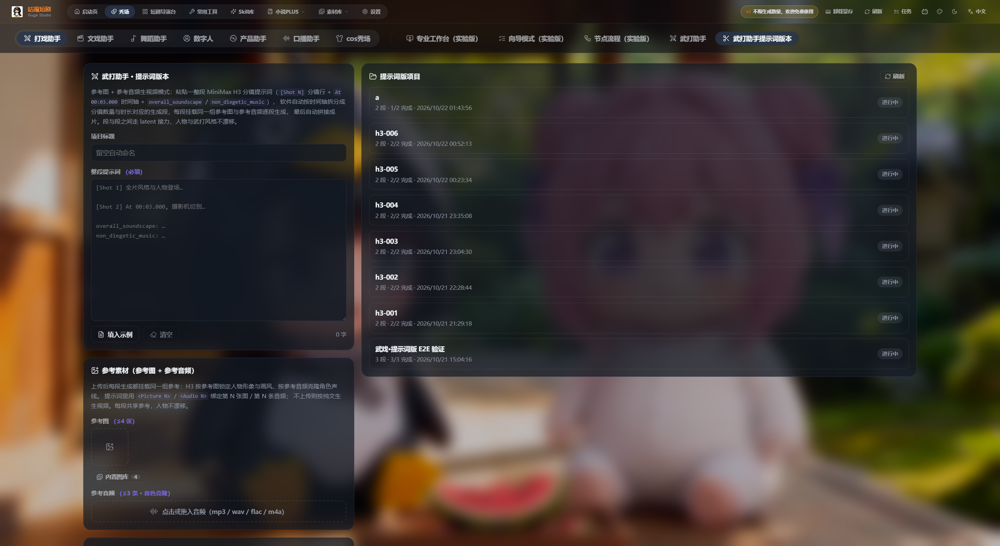

1. 秀场 → 打戏助手 → 武打助手提示词版本
2. 填项目标题（留空自动命名）
3. 整段提示词：用 `[Shot 1]`、`[Shot 2]` 标记每段，末尾补 `overall_soundscape` / `non_diegetic_music`；点「填入示例」看标准写法
4. 参考素材：参考图最多 4 张（第 1 张为主角色，提示词用 `<Picture 1>` 引用）+ 参考音频最多 3 条（克隆音色）
5. 点「解析预览」确认拆段 → 「一键生成成片」

> 原理：按时间轴拆成多段，每段挂同一组参考图与音频，段间走 latent 接力，因此人物与风格不漂。

---

## 3. 文戏助手

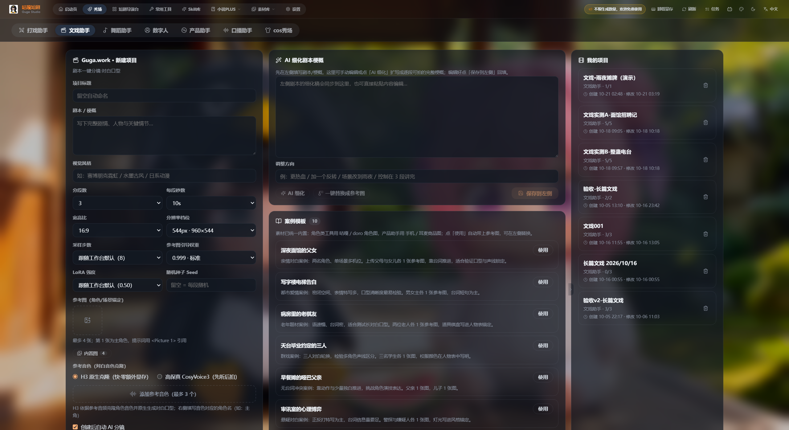

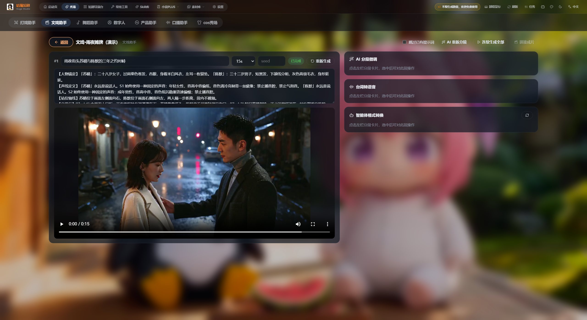

1. 秀场 → 文戏助手（副标题「剧本一键分镜·对白口型」）
2. 填「剧本 / 梗概」；或点「对话式创建」答四问（讲什么 / 角色靠什么锚定 / 什么风格 / 节奏规格）
3. 中栏「AI 细化剧本梗概」：填调整方向（如「更热血 / 加一个反转 / 场景改到雨夜」）→「AI 细化」→「保存到左侧」
4. 「案例模板」点「使用」自动带参考图；可「一键替换成参考图」换成你的角色
5. 设分段数 / 每段秒数 / 宽高比 / 分辨率档位 → 「创建项目」
6. 分镜工作台：分段卡片含人物锚定 / 声线定义 / 站位轴线；可用「AI 分段微调」「台词转配音」「智能体格式转换」；「连续生成全部」→「拼接成片」

> 台词转配音：选段 → 输入台词（每行一句）→ 选音色 → 生成配音（时间轴提取 → TTS → 替换音轨）。支持 H3 原生克隆（零额外显存）与高保真 CosyVoice3。

---

## 4. 多图舞蹈

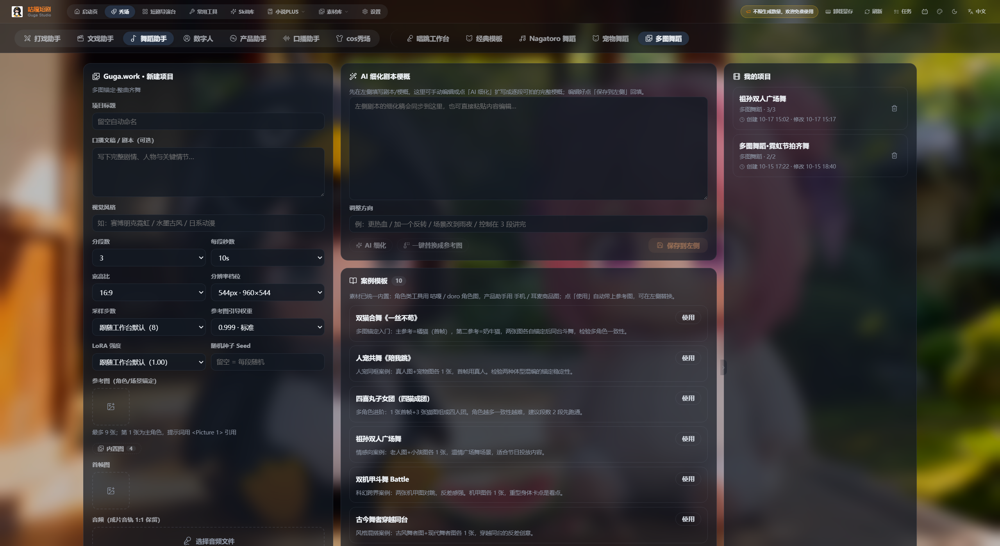

1. 秀场 → 舞蹈助手 → 多图舞蹈（副标题「多图锚定·整曲齐舞」）
2. 填口播文案/脚本（可选）+ 视觉风格
3. 参考图最多 **9 张**，第 1 张为主角色，提示词用 `<Picture 1>` 引用；再传首帧图
4. 音频：成片音轨 1:1 保留（**必填**）
5. 设参数 → 创建项目 → 分镜工作台 → 连续生成全部 → 拼接成片

> 专属模板：双强合舞、人宠共舞、四喜丸子女团、祖孙双人广场舞、双机甲斗舞 Battle 等。

---

## 5. 数字人

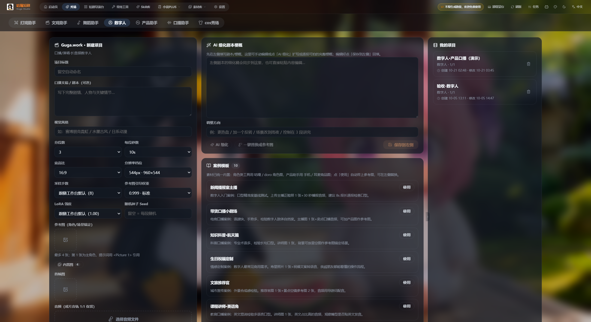

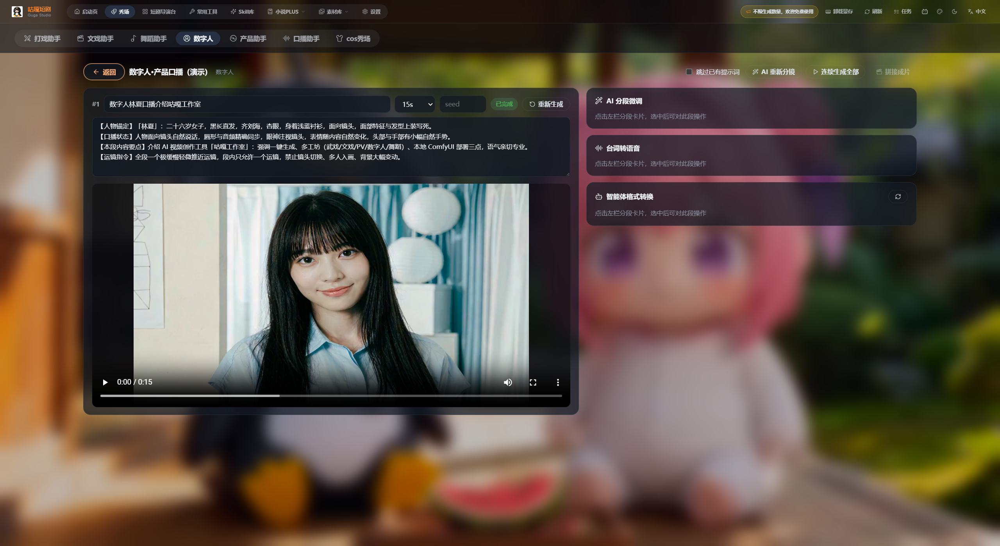

1. 秀场 → 数字人（副标题「口播/演唱·长音频数字人」）
2. 填口播文稿/剧本
3. 上传参考图（人物形象，第 1 张主角）与首帧图
4. 上传音频（口播/演唱），软件按音频长度自动分段接力
5. 创建 → 分镜工作台 → 连续生成全部 → 拼接成片

> 两大痛点：人物走形（提高参考图引导权重 / 换干净正面图）、口型不符（检查音频偏移；用「参考音色 + H3 原生克隆」）。

---

## 6. 产品 PV 工作台

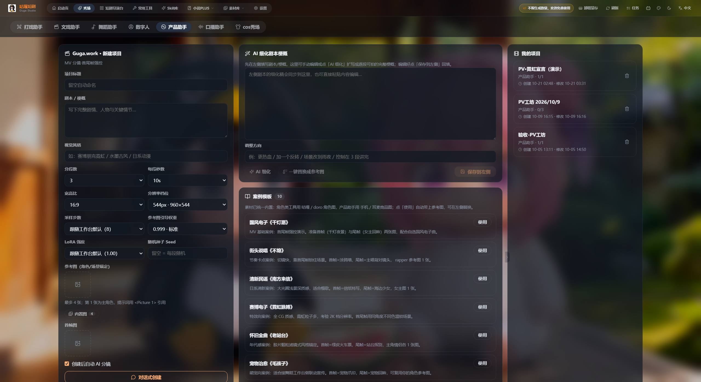

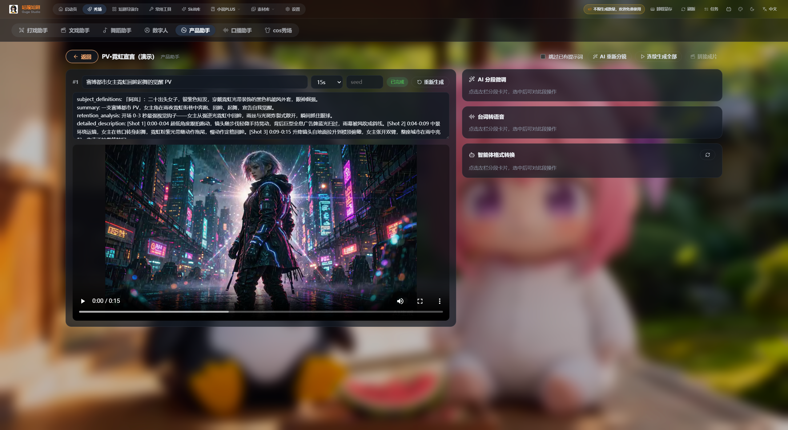

1. 秀场 → 产品助手（副标题「MV 分镜·首尾帧强控」）
2. 写清产品与卖点，含镜头语言（如「9 号样机实拍、追帧运镜、结尾定格」）
3. 参考图上传产品图（内置图库含手机/耳麦商品图），首帧图锁定开场
4. 可用对话式创建或案例模板：国风电子《千灯愿》、街头跑题《不炮》、清新国语《南方来信》、赛博电子《霓虹梦境》、怀旧金曲《老站台》、宠物治愈《毛孩子》
5. 创建 → 分镜工作台 → 连续生成全部 → 拼接成片

> 首尾帧强控是 PV 关键：首帧定开场定格、尾帧定收尾，能显著减少产品图变形。

---

## 7. 口播助手①：字幕转视频

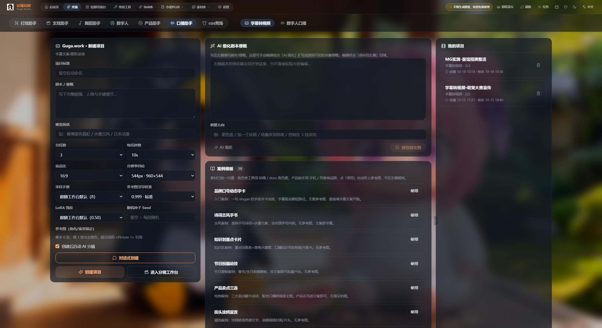

1. 秀场 → 口播助手 → 字幕转视频（副标题「字幕文案·图形动效」）
2. 口播文稿/字幕贴进「剧本/梗概」，一行一句最佳
3. 选视觉风格、分段数与每段秒数（建议 3–6 秒一段）
4. 创建（勾「创建后自动 AI 分镜」）→ 分镜工作台 → 连续生成全部 → 拼接成片

---

## 8. 口播助手②：数字人口播

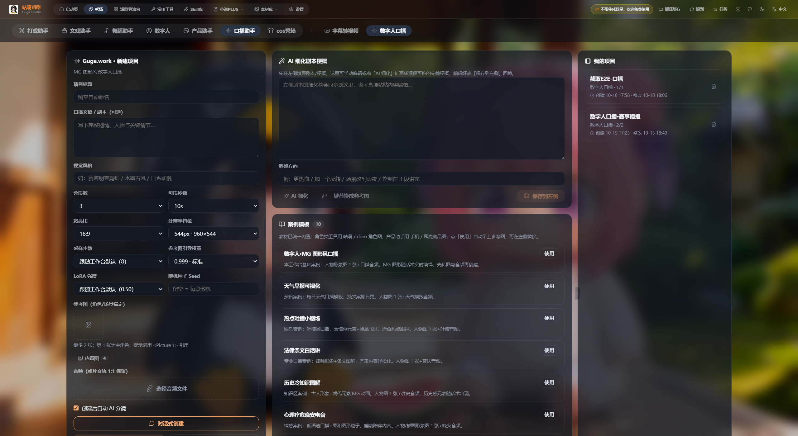

1. 秀场 → 口播助手 → 数字人口播（副标题「MG 图形风·数字人口播」）
2. 填口播文稿与视觉风格
3. 上传参考图（数字人形象）与音频（口播录音），软件自动分段、逐段唇形同步
4. 创建 → 分镜工作台 → 连续生成全部 → 拼接成片

> 字幕转视频 vs 数字人口播：没有出镜人物 → 字幕转视频；需要人物出镜 → 数字人口播。

---

## 9. 共用表单与参数手册

| 字段 | 说明 | 建议 |
| --- | --- | --- |
| 项目标题 | 留空自动命名 | 写清用途 |
| 剧本 / 梗概 | 完整剧情、人物与关键情节 | 写「场景 · 谁对谁 · 怎么收场」 |
| 视觉风格 | 赛博朋克霓虹 / 水墨古风 / 日系动漫… | 与分镜风格一致 |
| 分段数 / 每段秒数 | 总时长 = 分段数 × 每段秒数 | 打戏 5–8 秒，字幕 3–6 秒 |
| 宽高比 | 21:9 / 16:9 / 4:3 / 1:1 / 3:4 / 9:16 / 自适应 | 短视频选 9:16 |
| 分辨率档位 | 如 544px·960×544；短边 544–768，最高 2K | 12G 显存默认短边 768 |
| 采样步数 | 8 极速预览 / 20 质量最佳 | 免费档上限 8 步 |
| 参考图引导权重 | 0.999 最稳 | 漂移降 0.995/0.99；≤0.95 弱化贴图 |
| LoRA 强度 | 跟随工作台默认最稳 | 调大易过饱和 |
| 随机种子 | 留空 = 每段随机 | 固定可复现 |
| 参考图 / 首帧图 | 第 1 张为主角色，`<Picture 1>` 引用 | 多图舞蹈最多 9 张 |
| 音频 | 成片音轨 1:1 保留 | 舞蹈/数字人必填 |

分镜工作台：

- 左侧分段卡片：编辑本段梗概与完整 H3 提示词，生成/重试/重新生成
- 中段预览：视频与时长、设置分段时长与种子
- 右侧三件套：AI 分段微调 / 台词转配音 / 智能体格式转换
- 顶部四按钮：跳过已有提示词 / AI 重新分镜 / 连续生成全部 / 拼接成片

---

## 10. 常见问题与出片检查清单

| 现象 | 处理 |
| --- | --- |
| 提示「未找到可用视频模型」 | 设置 → AI 服务配置并启用视频服务 |
| 提示「本工作台需要先上传音频」 | 多图舞蹈 / 数字人 / 数字人口播必填音频 |
| 生成中显存溢出 | 分辨率降到 544px 短边、步数降到 8 |
| 人物走形 | 提高参考图引导权重到 0.999，换干净正面图，必传首帧图 |
| 口型对不上 | 检查音频偏移；优先用参考音色 + H3 原生克隆 |
| 段间风格跳 | 别改参考图；分段固定；勾「跳过已有提示词」 |
| 重新分镜冲掉已写提示词 | 勾选「跳过已有提示词」再点「AI 重新分镜」 |
| 成片拼接失败 | 有分段未生成成功，逐段重试再拼 |

提效：先建项目再改参数；用案例模板起步；「AI 细化 + AI 分段微调」两段式改稿；草稿用低档参数只重跑问题段；武打助手先选 Skill。

检查清单：

- [ ] 视频服务已配置且默认模型带 ⭐
- [ ] 标题、视觉风格、宽高比已按平台选定
- [ ] 剧本已填，分段数 × 每段秒数符合预期
- [ ] 参考图已上传，第 1 张是主角，首帧图已设置
- [ ] 需音频的工作台已上传音频
- [ ] AI 细化后的梗概已保存回左侧
- [ ] 分段提示词逐段检查过
- [ ] 全部分段「已完成」，无失败段
- [ ] 成片拼接成功并可播放
