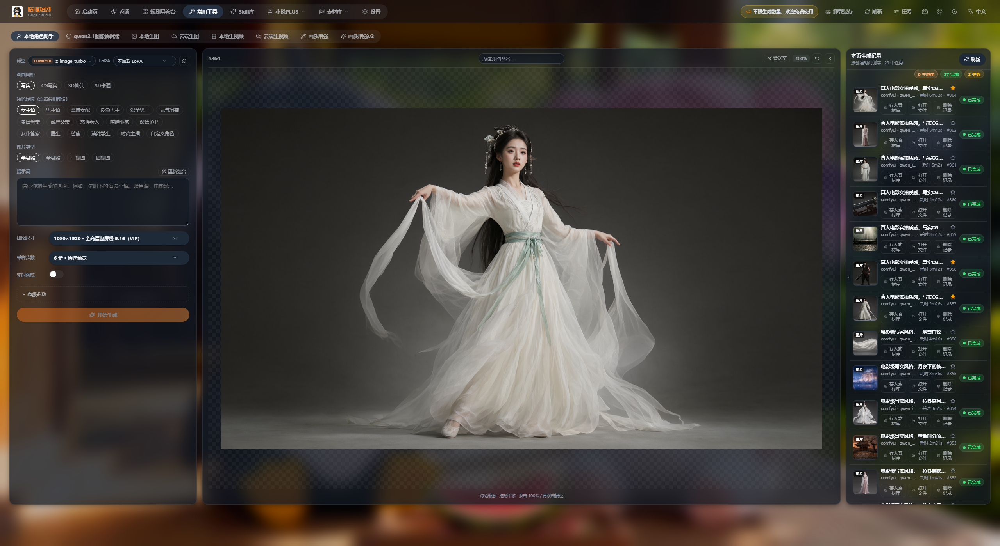
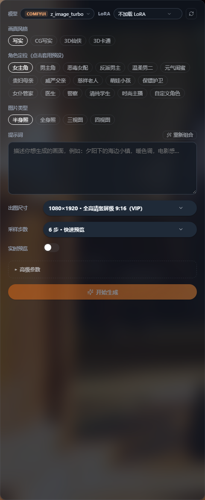
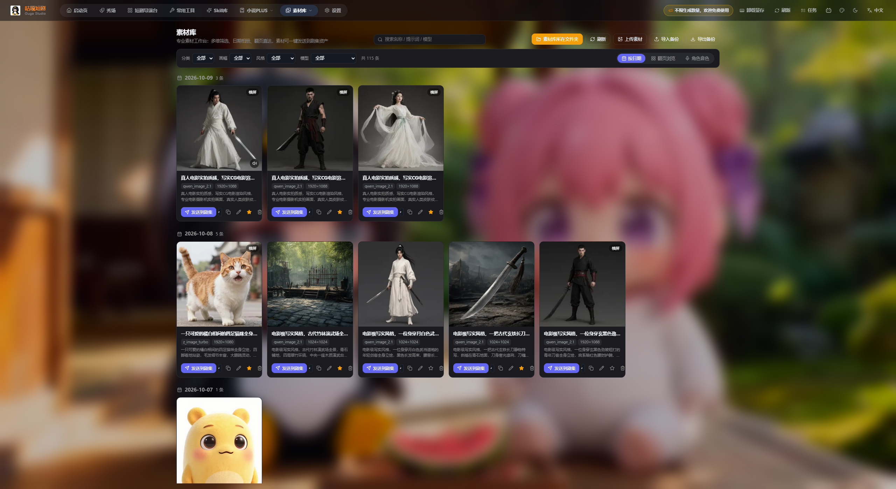
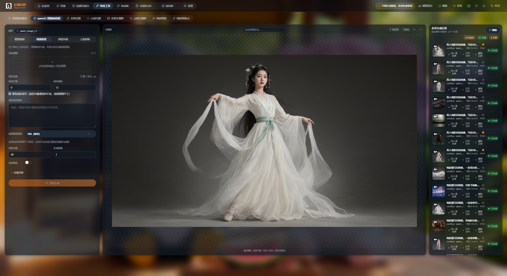
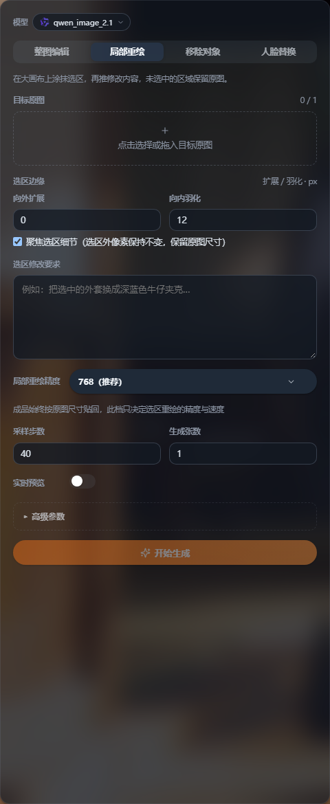
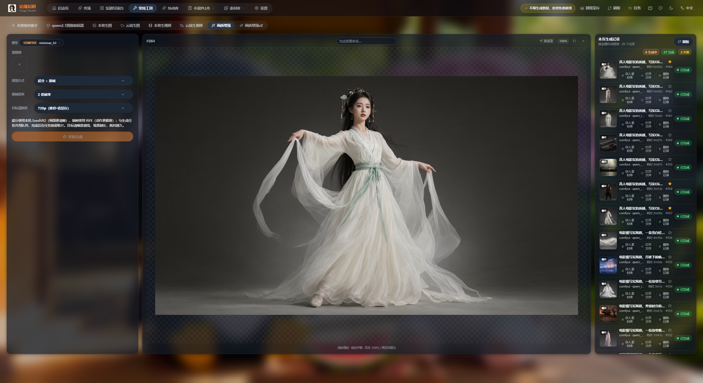
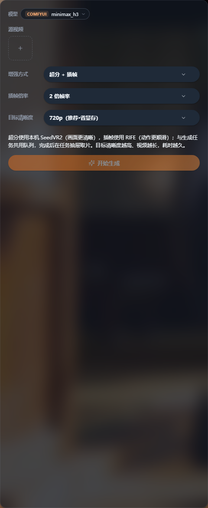
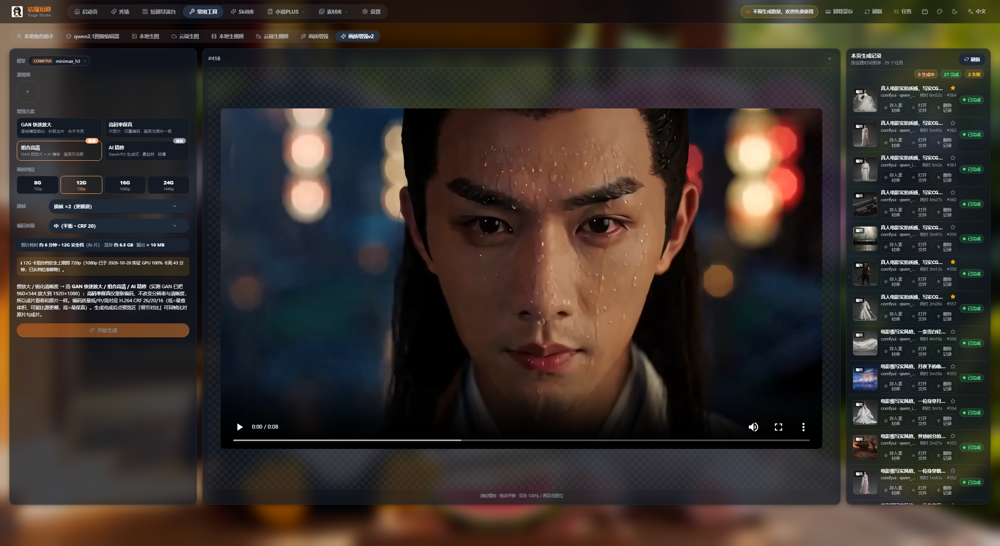
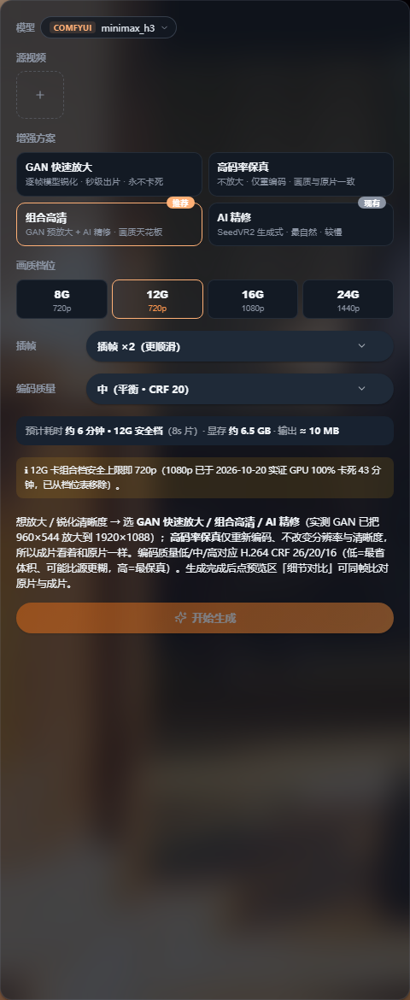

# 咕嘎AI漫剧 · 常用工具图文教程

> 入口：顶部导航 → **常用工具**
> 配套图文版（深色主题，含真实界面截图）：`咕嘎AI漫剧-常用工具图文教程.html`
> 图片目录：`图片/`

---

## 0. 常用工具页总览

8 个标签：**本地角色助手 / qwen2.1 图像编辑器 / 本地生图 / 云端生图 / 本地生视频 / 云端生视频 / 画质增强 / 画质增强v2**

三栏结构（所有标签通用）：

| 区域 | 内容 |
| --- | --- |
| 左栏 | 参数面板：模型、LoRA、提示词、尺寸、步数、模式选择等，随标签变化 |
| 中栏 | 预览舞台：滚轮缩放 / 拖动平移 / 双击 100%，顶部可命名、发送至、刷新、关闭 |
| 右栏 | 本页生成记录：状态统计、缩略图、时长、存入素材库 / 打开文件 / 删除记录、收藏 |

> 常用工具不依附任何短剧项目，产出可一键存入素材库，也可「发送至」剧集资产。

---

## 1. 本地角色助手

| 控件 | 说明 |
| --- | --- |
| 模型 | 默认 `COMFYUI z_image_turbo`（一键写入本地配置后可用），右侧可刷新 |
| LoRA | 下拉选择或手动输入文件名（在 `models/loras` 下），可调强度 |
| 画面风格 | 写实 / CG写实 / 3D仙侠 / 3D卡通 |
| 角色定位（点击套用预设） | 女主角、男主角、恶毒女配、反派男主、温柔男二、元气闺蜜、贵妇母亲、威严父亲、慈祥老人、萌娃小孩、保镖护卫、女仆管家、医生、警察、清纯学生、时尚主播……自定义角色 |
| 图片类型 | 半身照 / 全身照 / 三视图 / 四视图 |
| 提示词 | 按选择自动组合，可自由编辑；「重新组合」会覆盖手改内容 |
| 出图尺寸 | 预设档位（入门预览级 4:3、社交媒体通用级 16:9、全高清级 16:9、2K超清级、专业创作级 4:3、4K旗舰级；竖屏另有 9:16、3:4、19.5:9），也可自定义宽高（64~4096，8 的倍数） |
| 采样步数 | 4/6/8/12 等档位，步数越多越慢 |
| 实时预览 | 生成中在画布实时显示采样图 |
| 高级参数 | 种子（-1 随机）、CFG、负向提示词、采样器、调度器 |

流程：选风格 → 点角色定位 → 选图片类型 → 手动补外形描述 → 选尺寸与步数 → 开始生成 → 发送至剧集或存入素材库。

> 三视图 / 四视图一次出多角度、风格服装一致，直接当角色资产，分镜里人脸就不会乱跳。

---

## 2. 场景助手（未开发）

**当前状态（已在实际运行版本与源码中核对）**：常用工具标签栏只有上述 8 项，**没有「场景助手」入口**；前端源码与全部语言包中也检索不到该字样。因此目前**无法使用**。

规划中的定位：

- 与「本地角色助手」对称：预设分类 + 自动组合提示词 + 一键生成，批量产出室内/室外/街道/古代街市等场景图
- 每个场景像角色一样有「场景定位预设 + 多角度图 + 英文描述锚点」，保证同一部戏的空间一致
- 生成后入素材库，可一键发送到剧集的**场景资产**，供分镜作参考图

现在的替代方案：

| 方案 | 做法 | 适合 |
| --- | --- | --- |
| 本地生图 / 云端生图 | 提示词手写场景描述（主体+环境+光线+风格） | 单个场景、临时用 |
| qwen2.1 图像编辑器 | 用一张主图整图编辑 / 局部重绘派生出多个角度 | 已有主图想改细节 |
| **短剧导演台 · 项目素材库** | Agent 自动提取场景并出图，微调后存为项目资产 | **推荐**，场景与剧情强绑定 |

---

## 3. qwen2.1 图像编辑器

四种模式：

| 模式 | 做什么 |
| --- | --- |
| 整图编辑 | 按提示词整体修改画面（换背景、改服装、改风格） |
| 局部重绘 | 画布框选区域，只重绘这一块 |
| 移除对象 | 专用移除 LoRA（实验版）或仅提示词描述，可调消除强度 |
| 人脸替换 | BFS 身份增强（推荐）或仅提示词描述，可调身份增强强度 |

参数（局部重绘）：

| 字段 | 说明 |
| --- | --- |
| 目标原图 | 点击选择或拖入 |
| 选区边缘 | 向外扩展 / 向内羽化；勾「覆盖选区尺寸」保证选区外像素不变、保留原图尺寸 |
| 选区像素要求 | 描述要还原的细节，越具体越准 |
| 局部重绘基础模型 | 默认 `768（推荐）` |
| 采样步数 / 生成张数 | 40 步 / 1 张 |
| 实时预览 | 生成中画布实时显示 |
| 透明背景 | Qwen-Image-2.1 原生 RGBA，存为透明底 PNG |
| 高级参数 | 种子（-1 随机）、CFG、负向提示词 |

> **CFG 提示**：Qwen-Image-2.1 是蒸馏模型，**CFG=1 时负向提示词不参与采样**，要生效需调到大于 1（画质可能下降）。

---

## 4. 视频画质增强（v1）

| 参数 | 说明 |
| --- | --- |
| 源视频 | 上传或选择本地视频 |
| 增强方式 | `超分 + 插帧`（也可只做其中一项） |
| 插帧倍率 | 如 2 倍帧率 |
| 目标清晰度 | 如 `720p（推荐·省显存）`，越高越清晰、耗时越久 |

> 超分用本机 **SeedVR2**，插帧用 **RIFE**；与生成任务**共用队列**，完成后在任务抽屉取片。

v1 的取舍：只有一套固定组合，不能单独挑算法，也没有分辨率档位与编码质量可调；要更多控制请用 v2。

---

## 5. 视频画质增强 v2

| 方案 | 特点 | 推荐给 |
| --- | --- | --- |
| GAN 快速放大 | 逐帧模型锐化，秒级出片，永不卡死 | 老片抢救、时间紧 |
| 高码率保真 | 不放大，仅重编码，画质与原片一致 | 改善码率与兼容度 |
| **组合高清**（推荐） | GAN 预放大 + AI 精修，画质天花板 | 正式交付 |
| AI 精修 | SeedVR2 生成式，最自然，较慢 | 追求质感 |

| 参数 | 说明 |
| --- | --- |
| 分辨率档位 | `8G 720p` / `12G 720p` / `16G 1080p` / `24G 1440p` |
| 插帧 | `插帧 ×2（更顺滑）` |
| 编码质量 | `中（平衡 · CRF 20）`，CRF 越小越清晰体积越大 |
| 预计时长 / 临时显存 | 面板直接给出，用于排期 |

> v2 更稳的原因：GAN 路径把 960×544 放大到 1920×1088，避开单次分辨率与插帧叠加的显存峰值；配合低 CRF 编码（20/16）与「逐帧模型」「插帧」分离处理，显著降低跑一半崩掉的概率。

---

## 6. 生成记录与素材库互通

- 状态统计：生成中 / 已完成 / 失败；失败可「重新生成」按原参数重试
- 每条记录：缩略图 + 名称 + 模型 + 耗时，可存入素材库 / 打开文件 / 删除记录 / 收藏
- 右上「刷新」同步任务状态；「发送至」可把本地图片发到剧集资产
- 素材库支持按分类 / 画幅 / 风格 / 模型筛选，按日期相册分组，可改名、收藏、发送到剧集

推荐工作流：常用工具出图 → 存入素材库 → 挑选命名收藏 → 发送到剧集角色 / 场景框。

---

## 7. 常见问题与检查清单

| 现象 | 处理 |
| --- | --- |
| 提示「尚未配置可用的生图/视频服务」 | 设置 → AI 服务添加启用，或 ComfyUI 一键配置 |
| 尺寸/步数被锁 | 分辨率 0.6 以上、步数超 8、分辨率超 1920×1080、生成加速均属 VIP 功能 |
| 提示词被覆盖 | 「重新组合」会重写提示词，想保留手改就别点 |
| 局部重绘边缘突兀 | 勾「覆盖选区尺寸」，调向外扩展 / 向内羽化 |
| 负向提示词无效 | CFG=1 不参与采样，调到大于 1 |
| 画质增强排队久 | 共用队列；降档位或改用 GAN 快速放大 |
| 找不到增强后文件 | 任务抽屉取片，或记录里「打开文件」定位磁盘 |
| 找不到「场景助手」 | 未开发，改用本地生图或短剧导演台 → 项目素材库 |

检查清单：

- [ ] AI 服务已配置
- [ ] 模型选对（角色图 z_image_turbo / qwen_image_2.1，修图 qwen_image_2.1）
- [ ] 角色图已选风格 + 定位 + 类型，提示词补过外貌描述
- [ ] 尺寸档位与投放平台匹配
- [ ] 免费档步数 ≤ 8
- [ ] 局部重绘先框选区再写像素要求
- [ ] 画质增强按显存选对档位
- [ ] 成品已存入素材库并命名
- [ ] 素材已发送至剧集资产框
