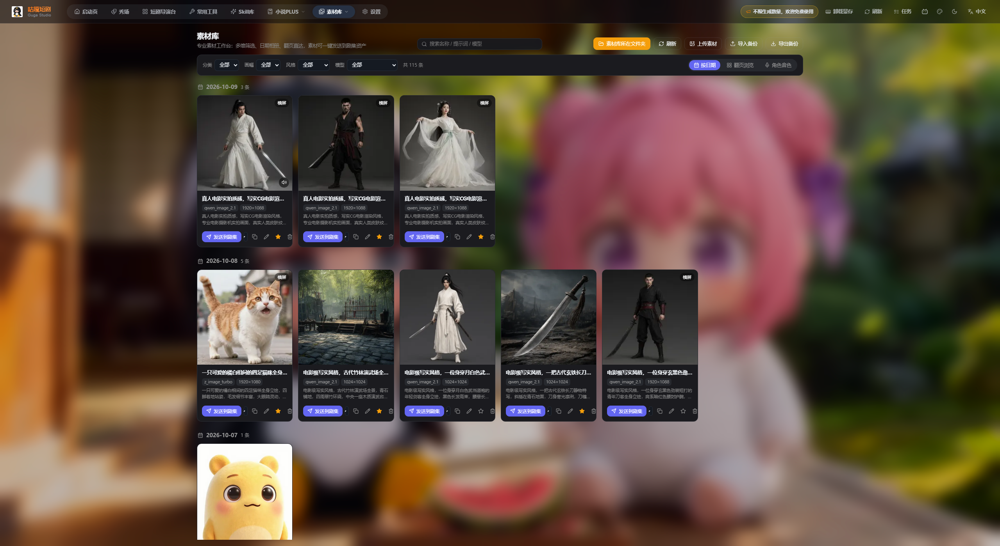
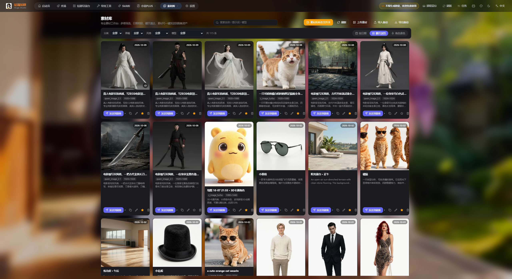
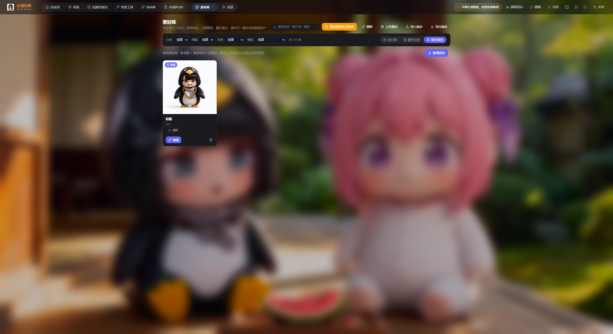
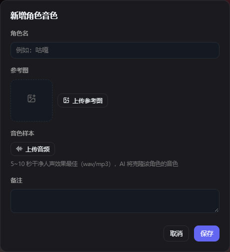
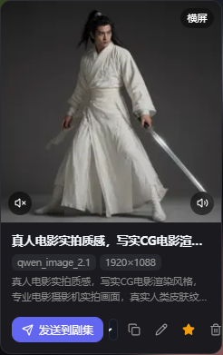
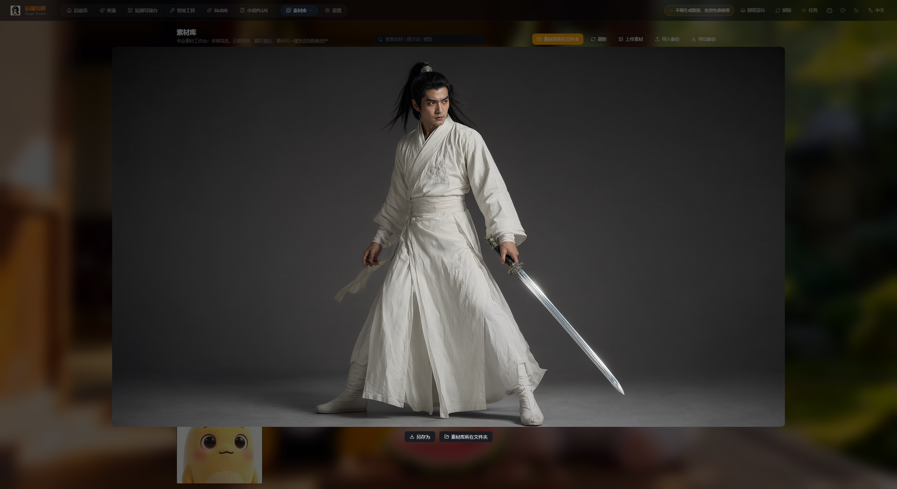
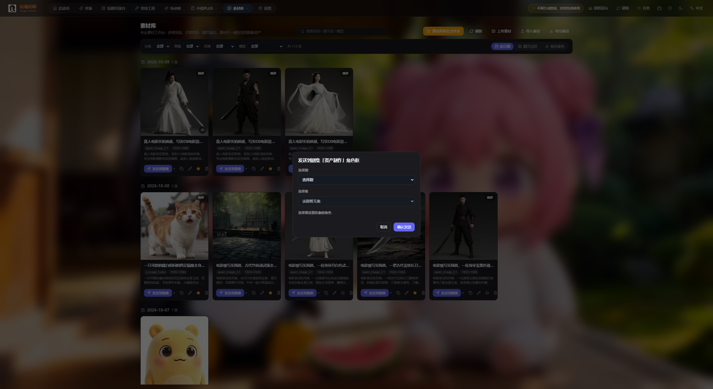
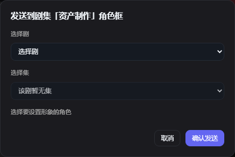
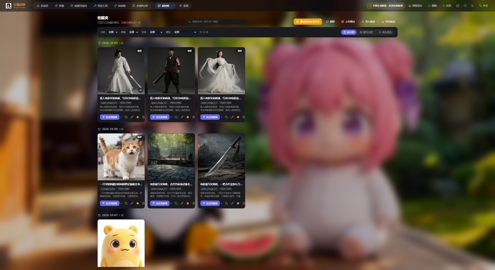

# 咕嘎AI漫剧 · 素材库图文教程

> 入口：顶部导航 → **素材库**（下拉里另有「收藏夹」）
> 配套图文版（深色主题，含真实界面截图）：`咕嘎AI漫剧-素材库图文教程.html`
> 图片目录：`图片/`

---

## 0. 素材库总览

素材库是全软件的「素材总仓」：所有生成过的图片集中管理，并可分发到剧集。

| 视图 | 适合什么时候用 |
| --- | --- |
| **按日期** | 刚做完一批图，按生成时间回溯；同一天聚在一组 |
| **翻页浏览** | 素材很多时一页页翻着看；卡片右上角标生成日期 |
| **角色音色** | 管理角色音色（参考图 + 音色样本），供配音与台词驱动生成复用 |

素材从哪来：① 常用工具生成后点「存入素材库」；② 短剧导演台生成的角色图/场景图自动入库；③ 手动「上传素材」导入本地图片。**删除记录不会删除磁盘文件**，删错了还能从「素材库所在文件夹」找回。

---

## 1. 页面结构与顶部工具条

| 按钮 | 作用 |
| --- | --- |
| 搜索名称 / 提示词 / 模型 | 一个搜索框同时匹配**名称、提示词、模型**三处 |
| 素材库所在文件夹 | 打开素材在磁盘上的真实目录 |
| 刷新 | 重新扫描目录、拉取最新素材 |
| 上传素材 | 批量把本地图片导入素材库 |
| 导入备份 | 从备份文件恢复素材记录 |
| 导出备份 | 把当前素材库导出成备份文件 |

筛选条四个维度：

| 维度 | 可选项 |
| --- | --- |
| 分类 | 男人 / 女人 / 老人 / 小孩 / 妖怪 / 野兽 / 风景 / 建筑 / 室内 / 道具 / 其他 |
| 画幅 | 横屏 / 竖屏 / 方图 |
| 风格 | 写实 / CG写实 / 3D仙侠 / 3D卡通 |
| 模型 | 按生成模型筛选（如 qwen_image_2.1、z_image_turbo） |

右侧实时显示「共 N 条」，多维度可叠加。

---

## 2. 视图① 按日期

每个日期一行标题（如 2026-10-09 · 3 条），下方是当天素材卡。卡片含：缩略图、右上角分类标签与收藏星标、名称 + 模型 + 尺寸、提示词摘要（悬停看全文）、底部操作条。

---

## 3. 视图② 翻页浏览

网格更紧凑，卡片右上角标生成日期，底部有页码与「/ 总页数」。

> 「按日期」适合按批次找；「翻页浏览」适合按张数挑。筛选条在两种视图里都生效。

---

## 4. 视图③ 角色音色

说明：角色音色库 = 参考图 + 音色样本一次绑定，配音 / 台词驱动生成时全项目复用。

| 字段 | 说明 |
| --- | --- |
| 角色名 | 例如「咕嘎」 |
| 参考图 | 该角色形象图，上传后与音色绑定 |
| 音色样本 | 5~10 秒干净人声（wav/mp3）效果最佳，AI 会克隆该角色音色 |
| 备注 | 可选，说明角色语气或用途 |

> 音色怎么用：在短剧导演台分镜工作台的「参考音色（对白音色克隆）」里最多加 3 个，填「对应角色名」（如：主角）；或选「高保真 CosyVoice3」先听后拍。素材卡片右下角还能绑定音频并试听。

---

## 5. 素材卡片与按钮

| 按钮 | 作用 |
| --- | --- |
| 发送到剧集 | 把素材指派到某个剧集某个集的角色形象框 |
| 复制 | 复制素材到素材库（生成副本），原件保留 |
| 编辑 | 修改名称、提示词等素材信息 |
| 收藏（星标） | 加入收藏夹 |
| 删除（垃圾桶） | 删除记录，二次确认；**磁盘文件保留** |

> 提示原文：「确定删除该素材吗？文件保留在磁盘，仅移除记录」。

---

## 6. 发送到剧集

1. 素材卡上点 **发送到剧集**
2. **选择剧**：挑目标短剧
3. **选择集**：挑具体某一集；提示「该剧暂无集」说明要先在导演台建集
4. **选择要设置形象的角色**：已设过形象的会标「已有形象」
5. **确认发送** → 提示「已发送到角色形象框，刷新剧集页即可看到」

> 典型用法：做出角色三视图 → 发送到剧集 → 指定集 → 指定角色。此后该角色在分镜里以这张图为形象锚点，跨镜头人脸一致。

---

## 7. 收藏夹

- **加入/移出**：卡片上点星标
- **进入**：顶部导航「素材库」悬停展开下拉 → 选「收藏夹」（地址 `/library?view=favorites`）
- 收藏夹内素材同样可发送、编辑、删除

---

## 8. 上传、备份与迁移

**上传素材**：点顶部「上传素材」→ 选择本地图片（可多选），成功会提示成功/失败条数；导入素材会按画面自动判分类别与画幅，可再手动改名与补提示词。

| 操作 | 说明 | 典型场景 |
| --- | --- | --- |
| 导出备份 | 把当前素材库导出成备份文件 | 换电脑、重装系统前存档 |
| 导入备份 | 从备份文件恢复，提示「成功 N 条 / 跳过 M 条」 | 新机器恢复素材库 |

> 备份文件格式不对会提示「备份文件格式不正确」，别改后缀，用软件导出的文件即可。
> 「素材库所在文件夹」直接打开磁盘目录，批量重命名、换分辨率、找回被删记录都在这里最方便。

---

## 9. 常见问题与检查清单

| 现象 | 处理 |
| --- | --- |
| 看不到刚生成的图 | 常用工具生成后要点「存入素材库」；入库后点「刷新」 |
| 发送剧集提示「该剧暂无集」 | 先去导演台创建集 |
| 发送后剧集里看不到 | 按提示刷新剧集页，核对集与角色 |
| 删掉的素材能找回吗 | 能，文件保留在磁盘，到「素材库所在文件夹」找回再上传 |
| 搜索不到素材 | 搜索匹配名称/提示词/模型；先清掉筛选条条件 |
| 导入备份没反应 | 必须是本软件导出的备份文件 |
| 音色试听没声音 | 未绑定的会显示「未绑定音色样本」，先上传样本 |
| 角色在剧集里长得不一样 | 把定妆照「发送到剧集」指定角色作为形象锚点 |

检查清单：

- [ ] 配置好生成模型
- [ ] 常用工具生成后点「存入素材库」
- [ ] 用四维筛选快速定位素材
- [ ] 定妆照、场景底图打星标进收藏夹
- [ ] 给素材改好名字与提示词
- [ ] 定妆照已发送剧集并锁定形象
- [ ] 常用角色已绑参考图与音色样本
- [ ] 删素材前已确认（记录可删，文件保留）
- [ ] 换电脑前已「导出备份」
- [ ] 批量核对时切到「翻页浏览」
